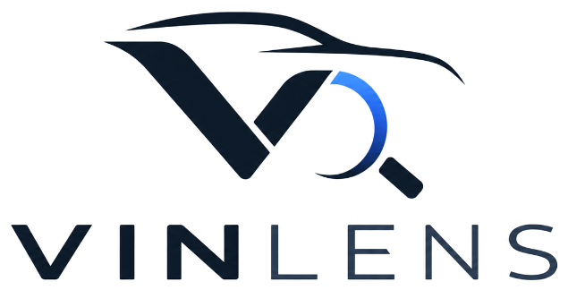

# VinLens — VIN Decoder & Vehicle History Check

VinLens is a modern, high-performance vehicle history reporting and automotive VIN decoding web application. Built with React 19, TypeScript, Tailwind CSS, and Vite, VinLens provides instant access to official NMVTIS title checks, accident records, odometer rollback audits, and verified factory technical specifications.



## ✨ Key Features

- **Instant 17-Digit VIN & US License Plate Lookup**: Dual lookup modes supporting direct 17-character VIN verification or US State + License Plate lookup.
- **Interactive Vehicle Inspection Showcase**: 
  - Dynamic showroom vs. damage comparison spotlight inspector.
  - Floating diagnostic telemetry badges (Clean vs. Salvage Title, Odometer Verification, Accident History).
  - Continuous 3D levitation float animation and autonomous touchscreen patrol scan.
- **Certified Vehicle History Audit Reports**:
  - Executive diagnostic summary with 4 KPI metrics.
  - Verified OEM manufacturer technical specifications matrix.
  - Accident & collision assessment log with frame integrity verification.
  - Multi-owner chronological history timeline.
  - Odometer progression log with rollback shield analysis.
  - 50-State NMVTIS title brand registry audit.
  - Certified print & PDF generation formatting with smart filename tagging.
- **32+ Global Vehicle Makes**: Powered by official car brand logos with MotoMarks integration and fast search filtering by country/region.
- **Visual "Where to Find Your VIN" Guide**: Interactive 4-checkpoint physical inspection guide with verified sample vehicles.
- **Simulated Authentication System**: Sign in, registration, and user session management with sample accounts.

## 🛠️ Tech Stack

- **Framework**: [React 19](https://react.dev/) + [TypeScript](https://www.typescriptlang.org/)
- **Bundler & Build Tool**: [Vite](https://vitejs.dev/)
- **Styling**: [Tailwind CSS v4](https://tailwindcss.com/)
- **Icons**: [@hugeicons/react](https://hugeicons.com/) & [lucide-react](https://lucide.dev/)
- **Fonts**: Plus Jakarta Sans, Public Sans, JetBrains Mono
- **Logos**: [MotoMarks.io](https://motomarks.io)

## 🚀 Getting Started

### Prerequisites

- Node.js (v18.0.0 or higher)
- npm, pnpm, or yarn

### Installation

1. Clone the repository:
   ```bash
   git clone https://github.com/ashishorbital/VinLens-VIN-Decoder-Vehicle-History-Check.git
   cd VinLens-VIN-Decoder-Vehicle-History-Check
   ```

2. Install dependencies:
   ```bash
   npm install
   ```

3. Start the local development server:
   ```bash
   npm run dev
   ```

4. Build for production:
   ```bash
   npm run build
   ```

## 📄 License

This project is licensed under the MIT License.
